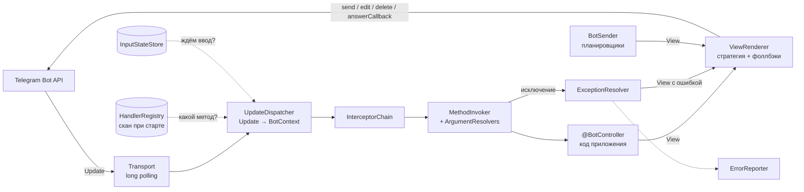

# Проектная документация telegram-mvc

Переработанная версия документа «Конструктор ботов» (черновик v0.2, 10.10.2026).
Исходный документ описывал внутренний модуль manageapp; здесь он приведён к библиотеке,
которая про manageapp ничего не знает. План работ — в [ROADMAP.md](ROADMAP.md).

## 1. Цель и мотивация

Новый Telegram-бот описывается контроллером с аннотациями, как `@RestController` в Spring MVC.
Маршрутизацию, отрисовку и обработку ошибок берёт на себя ядро.

Откуда задача — состояние ботов в manageapp (ветка `feature/et-85`):

| Что | Сколько |
|---|---|
| Фасадов, унаследованных от `TelegramFacade` | 10 |
| Мест с одинаковым поиском хендлера по мапе | 27 |
| Классов `*UpdateHandler`, каждый сам разбирает `Update` | ~80 |
| Багов, найденных из-за копипаста фасада | 1 |

Пример: в одном из фасадов пользователи регистрировались с идентификатором чужого бота,
а повторная регистрация команды писала `log.error` и всё равно перезаписывала хендлер.
В библиотеке регистрация маршрутов одна на всех, и конфликт останавливает запуск приложения.

### Критерии успеха

- Новый бот: токен в `application.yaml` и один или несколько контроллеров. Ни фасада, ни наследника `TelegramLongPollingBot`.
- Перенесённый бот заметно короче: на первом переносе считаем строки до и после.
- Хендлер не трогает `Update` и ничего не отправляет сам, а возвращает `View`.
- Любой хендлер проверяется тестом без Telegram.

Главный риск — застрять на идеальном ядре и не довести переносы. Успех измеряется ботами,
которые на нём работают, а не числом фич.

## 2. Границы

- **Не стейт-машина.** Всё stateless. Единственное исключение — ожидание ввода (раздел 11).
- **Не no-code.** Инструмент для программиста, сценарии пишутся кодом.
- **Только long polling.** Ядро не зависит от способа получения апдейтов, но webhook не делается до реальной потребности.
- **Без лишнего.** i18n, групповые чаты и inline-режим — тоже только по потребности.
- **Без большого переезда.** В приложении старый код и боты на библиотеке живут рядом, боты переносятся по одному.
- **Библиотека не знает про приложение.** Пользователи, хранилище, отчёты и права — через SPI с реализацией по умолчанию.

## 3. Термины

| Термин | Значение |
|---|---|
| **Update** | Сырой объект Telegram API: любое действие пользователя. |
| **Command** | Текст, начинающийся с `/`. Точка входа в сценарий, как ввод URL в браузере. Может нести аргументы: `/q кошки`, `/start ref_42`. |
| **Action** | Нажатие инлайн-кнопки (callback query). Основной двигатель сценария. |
| **Payload** | Данные кнопки (`callback_data`). Через них передаётся состояние. Формат `domain:action:arg`, лимит 64 байта. |
| **Message** | Сообщение без `/`: свободный текст, фото, голосовое, документ. |
| **View** | Описание ответа: текст, медиа, клавиатура, стратегия, всплывающее уведомление. Хендлер возвращает View и ничего не отправляет сам. |
| **RenderStrategy** | Как доставить View: `AUTO`, `NEW`, `EDIT`, `REPLACE`, `DELETE`, `NONE`. |
| **Flow** | Цепочка переходов между View: независимые хендлеры, связанные через payload кнопок. |
| **AwaitInput** | Отметка «следующее сообщение этого чата отдать хендлеру X». Единственное хранимое состояние. |
| **BotContext** | Разобранный апдейт: имя бота, тип, чат, `ChatUser`, id сообщения, ключ маршрута, аргументы. |
| **ArgumentResolver** | Подставляет значения в параметры метода хендлера. |
| **Interceptor** | Код до и после хендлера: логирование, права, защита от двойного клика, регистрация пользователя в приложении. |

## 4. Сценарии

| # | Сценарий | Триггер → ответ | Состояние | Пример |
|---|---|---|---|---|
| 1 | Команда → ответ | `/stats` → NEW, сценарий закончен | нет | справки, статистика |
| 2 | Меню на кнопках | `/menu` → NEW, дальше кнопки → EDIT того же сообщения; терминальная кнопка удаляет меню или пишет итог | в payload | настройки, пагинация, модерация |
| 3 | Ввод данных | кнопка «Добавить» → «Пришли текст», затем текст → хендлер ввода → NEW | AwaitInput | форма бронирования |
| 4 | Свободный текст и медиа | текст или фото без команды → хендлер по типу → NEW | нет | AI-ассистент, фото еды |
| 5 | Долгая операция | запрос → сразу «⏳ Думаю…» (NEW) → результат EDIT поверх | нет | AI-вызовы, парсинг |
| 6 | Проактивное сообщение | планировщик → тот же View через `BotSender` | нет | отчёты, напоминания, рассылки |
| 7 | Ошибка | исключение в хендлере → понятный текст (или alert на кнопке) + `ErrorReporter` | нет | везде |

## 5. Архитектура



### Путь апдейта

1. **Транспорт** получает апдейт и передаёт его диспетчеру вместе с именем бота. Обработка идёт в пуле потоков, порядок апдейтов одного чата сохраняется.
2. **UpdateDispatcher** собирает `BotContext`: тип (команда, кнопка, ввод, текст, медиа), chatId, пользователь, messageId, ключ маршрута, аргументы.
3. Диспетчер выбирает хендлер по порядку из раздела 8: спрашивает **InputStateStore**, ждём ли ввод, и ищет метод в **HandlerRegistry**.
4. **InterceptorChain** выполняет общий код. Любой интерцептор может прервать обработку и вернуть свой View.
5. **MethodInvoker** собирает аргументы через ArgumentResolvers и вызывает метод.
6. **Контроллер** выполняет бизнес-логику и возвращает `View`, `List<View>`, `String` или `null`.
7. Исключение ловит **ExceptionResolver**: `@BotExceptionHandler` контроллера → `@BotControllerAdvice` → встроенный. Он формирует View с ошибкой и вызывает `ErrorReporter` для неожиданных ошибок.
8. **ViewRenderer** выбирает стратегию, собирает `SendMessage`, `EditMessageText` и т.д., выполняет запрос и обрабатывает ответы Telegram по таблице из раздела 9.

### Компоненты

| Компонент | Ответственность |
|---|---|
| `HandlerRegistry` | Находит бины с `@BotController` (`SmartInitializingSingleton`) и строит таблицу маршрутов на каждого бота. Проверяет конфликты и сигнатуры; при ошибке приложение не запускается. |
| `UpdateDispatcher` | Превращает Update в BotContext и выбирает маршрут. |
| `MethodInvoker` | Вызывает метод через `MethodHandle`, подготовленный при старте. |
| `ArgumentResolver` | SPI: `supports(MethodParameter)`, `resolve(BotContext, MethodParameter)`. Пользовательские резолверы подхватываются как бины. |
| `InterceptorChain` | Упорядоченный список `BotInterceptor` (раздел 13). |
| `ExceptionResolver` | Превращает исключения в View и отчёты (раздел 12). |
| `ViewRenderer` | Вместе с транспортом — единственное место, которое знает классы telegrambots. Обновление её версии затрагивает только эти два пакета. |
| `InputStateStore` | SPI: «чего ждём» по паре бот + чат, с TTL (раздел 11). |
| `BotSender` | `send(bot, chatId, View)` для кода вне хендлеров. |
| `BotResponder` | Параметр хендлера для промежуточных ответов: «печатает…», «⏳ Думаю…», затем финальный View. |
| `CallbackData` | Сборка и разбор payload, проверка 64 байт, короткие id для длинных данных (раздел 10). |

## 6. API контроллера

### Аннотации

| Аннотация | На что реагирует |
|---|---|
| `@BotController(bot = "notes")` | Класс с хендлерами. `bot` обязателен: в одном приложении может быть несколько ботов. |
| `@CommandHandler("/start")` | Команда. `description` — для `/help` и меню команд, `hidden` — для служебных команд. |
| `@ActionHandler("usr:del:{id}")` | Кнопка. Шаблон с переменными, `*` в конце — любой хвост. |
| `@InputHandler("note:text")` | Сообщение, которого ждали после `View.awaitInput("note:text")`. |
| `@TextHandler` | Любой текст без команды и без ожидания ввода. Не больше одного на бота. |
| `@PhotoHandler`, `@VoiceHandler`, `@DocumentHandler` | Медиа по типу. |
| `@FallbackHandler` | Всё, что не подошло: неизвестная команда, устаревшая кнопка. Без него — встроенный ответ со ссылкой на `/help`. |
| `@BotExceptionHandler(X.class)` | Обработка исключения в пределах контроллера. |
| `@RequiresAccess("admin")` | Метка для `AccessPolicy`; на класс или метод. |

### Параметры метода

| Параметр | Что подставляется |
|---|---|
| `ChatUser user` | Пользователь Telegram: id, username, имя, язык. Свой тип пользователя приложение подставляет своим резолвером. |
| `@ChatId long chatId` | Id чата. |
| `@MessageId Integer id` | Id сообщения с кнопкой или входящего сообщения. |
| `@Param long id` | Переменная шаблона `{id}`; конвертация через Spring `ConversionService`: `long`, `int`, `String`, `UUID`, `enum`, `LocalDate`. |
| `@Args String args` | Хвост команды: `/q кошки` → `"кошки"`. |
| `@Text String text` | Текст сообщения. |
| `@InputData String data` | Данные, сохранённые вместе с ожиданием ввода. |
| `PhotoSize`, `Voice`, `Document` | Медиа из сообщения (у фото — наибольший размер). |
| `BotResponder responder` | Промежуточные ответы в долгих операциях. |
| `BotContext ctx`, `Update update` | Запасной выход на всё сразу. |

Типы возврата: `View`, `List<View>`, `String` (короткая запись для простого текста), `void`/`null`.
На нажатие кнопки ядро в любом случае отвечает `answerCallbackQuery`, чтобы кнопка не «крутилась».

### Пример

```java
@BotController(bot = "notes")
@RequiredArgsConstructor
public class NotesController {

    private final NoteService noteService;

    @CommandHandler(value = "/start", description = "Главное меню")
    public View start(ChatUser user) {
        return menu(user);                       // команда → AUTO = NEW
    }

    @ActionHandler("nav:main")
    public View main(ChatUser user) {
        return menu(user);                       // кнопка → AUTO = EDIT
    }

    @ActionHandler("note:add")
    public View askText() {
        return View.text("Пришли текст заметки")
                .awaitInput("note:text")
                .row().button("Отмена", "nav:main")
                .build();
    }

    @InputHandler("note:text")
    public View save(ChatUser user, @Text String text) {
        noteService.save(user.id(), text);
        return View.text("Сохранено")
                .row().button("Назад", "nav:main")
                .build();
    }

    @ActionHandler("note:del:{id}")
    public View delete(ChatUser user, @Param long id) {
        noteService.delete(user.id(), id);       // NoteNotFound extends BotUserException
        return menu(user).toBuilder().toast("Удалено").build();
    }

    @BotExceptionHandler(LimitExceededException.class)
    public View limit(LimitExceededException e) {
        return View.alert("Лимит " + e.getLimit() + " заметок");
    }

    private View menu(ChatUser user) {
        return View.text("Заметок: " + noteService.count(user.id()))
                .row().button("Добавить", "note:add")
                .row().button("Показать", "note:list:0")
                .build();
    }
}
```

## 7. View

| Поле | Назначение |
|---|---|
| `text` | Текст или подпись к медиа. |
| `keyboard` | Ряды кнопок через явный `.row()`; `button`, `urlButton`, reply-клавиатура, `removeKeyboard()`. |
| `strategy` | По умолчанию `AUTO`, указывать нужно редко. |
| `parseMode` | HTML по умолчанию. Экранирование явное: `Html.escape()`. |
| `photo` / `document` | Медиа: `byte[]`, файл, URL или `file_id`. |
| `toast` / `alert` | Текст для `answerCallbackQuery`: короткое уведомление или модальное окно. |
| `awaitInput` | Ключ `@InputHandler` и необязательные данные (раздел 11). |
| `disablePreview`, `silent` | Без превью ссылок, без звука. |

View неизменяемый; `toBuilder()` даёт копию для правки.

| Стратегия | Действие |
|---|---|
| `AUTO` | Команда, ввод, текст, медиа → `NEW`. Кнопка → `EDIT`. |
| `NEW` | `sendMessage` / `sendPhoto` / `sendDocument`. |
| `EDIT` | `editMessageText` / `editMessageCaption` / `editMessageMedia` сообщения с кнопкой. |
| `REPLACE` | Удалить сообщение с кнопкой и отправить новое. Нужно при смене типа: был текст, стало фото. |
| `DELETE` | Удалить сообщение с кнопкой, например по «Закрыть». |
| `NONE` | Ничего не отправлять, только ответить на callback (toast). |

## 8. Маршрутизация

### Порядок выбора хендлера

1. **Callback query** → `@ActionHandler` по шаблону. Ожидание ввода не сбрасывается: кнопка «Отмена» сама решает, что делать.
2. **Текст с `/`** → `@CommandHandler`. Суффикс `@botname` отрезается, хвост идёт в `@Args`. Любая команда сбрасывает ожидание ввода.
3. **Есть ожидание ввода** для бота и чата → `@InputHandler`.
4. **Медиа** → `@PhotoHandler` и др. по типу.
5. **Текст** → `@TextHandler`.
6. Ничего не подошло → `@FallbackHandler` или встроенный ответ.

### Шаблоны для кнопок

- Payload делится по `:`, шаблон сравнивается по сегментам: `usr:del:{id}` подходит для `usr:del:145`.
- Приоритет: точное совпадение → больше литеральных сегментов → переменные → `*`.
- Индекс: мапа по первому сегменту (`usr`), внутри — отсортированный короткий список шаблонов.
  Простой `HashMap<String, Method>` по префиксу не работает: `map.get` префиксы не ищет.

### Проверки при старте

Приложение не запускается, если найдено:

- два хендлера одного бота с одинаковым ключом или шаблоном одинаковой формы;
- контроллер для бота, которого нет в конфигурации;
- параметр без резолвера или `@Param` без переменной в шаблоне;
- неподдерживаемый тип возврата;
- больше одного `@TextHandler` или `@FallbackHandler` (и каждого медиа-хендлера) на бота.

`@InputHandler` с ключом, который нигде не используется, даёт только предупреждение в лог.

## 9. Правила отрисовки

Telegram не даёт редактировать старые сообщения и сообщения без изменений. Ядро обрабатывает это само:

| Ситуация | Поведение ядра |
|---|---|
| EDIT, но редактировать нечего (команда, планировщик) | Отправить как NEW. |
| `message is not modified` | Тихо проигнорировать. |
| `message can't be edited` / `message to edit not found` | Отправить как NEW, лог на уровне debug. |
| EDIT текстом поверх сообщения с медиа | `editMessageCaption`; при смене типа (текст ↔ медиа) — REPLACE. |
| Нажатие кнопки | Ровно один `answerCallbackQuery` на callback: с toast/alert из View или пустой. |
| 403, бот заблокирован | Событие `BotBlockedEvent`; что делать с пользователем, решает приложение. |
| 429, слишком много запросов | Подождать `retry_after` и повторить один раз. Для рассылок — ограничение скорости в `BotSender`. |
| Текст длиннее 4096 символов (подпись — 1024) | Для NEW разбить по абзацам. Для EDIT — исключение (ошибка разработчика). |
| `can't parse entities` | Повторить без parseMode и записать warn: где-то забыто экранирование. |

## 10. Callback data

- Формат `domain:action:arg…`, лимит 64 байта **в UTF-8**, а не в символах: кириллица занимает 2 байта. В payload — латиница и цифры.
- Сборка через `CallbackData.of("usr", "del", id)` вместо конкатенации. Превышение лимита или `:` внутри сегмента — исключение в `build()`, поэтому ловится тестом, а не пользователем.
- Длинные данные (фильтры, URL) — через `ShortIdStore`: в кнопку кладётся короткий ключ, данные лежат в хранилище с TTL. Протухший ключ → понятный fallback «Меню устарело».
- Кнопки в старых сообщениях живут вечно. Хендлер должен переживать удалённые сущности, например бросать `BotUserException("Уже удалено")`.

## 11. Ожидание ввода

Stateless-подход хорош для кнопок, но свободный текст в кнопку не зашить.
Поэтому есть минимальное состояние: одна запись на пару бот + чат.

```java
record AwaitInput(String bot, long chatId,
                  String key,          // "note:text" → @InputHandler("note:text")
                  String data,         // необязательный контекст, например id редактируемой записи
                  Instant expiresAt)   // TTL, по умолчанию 15 минут
```

- Ставится через `View.awaitInput(key, data)`, снимается после успешного `@InputHandler`.
- Любая команда сбрасывает ожидание. Хендлер может вернуть `awaitInput` снова, например чтобы попросить повторить ввод при ошибке валидации.
- Ждали текст, пришло фото → ответ «Жду текст», ожидание сохраняется.
- Хранилище — SPI `InputStateStore`. По умолчанию в памяти с TTL (`telegram-mvc.input.ttl`);
  приложение может подменить его на БД, чтобы ожидание переживало рестарт.

## 12. Ошибки

| Класс | Что видит пользователь | Что в логах и `ErrorReporter` |
|---|---|---|
| `BotUserException` | Текст исключения: «Заметка не найдена». На кнопке — alert. | info, без отчёта. |
| Ошибка разработчика | «Что-то пошло не так» (текст настраивается). | error и вызов `ErrorReporter`: бот, чат, маршрут, исключение. |
| Ошибка Telegram API | Обычно ничего, по таблице из раздела 9. | warn; отчёт только для неизвестных кодов. |

Порядок поиска обработчика: `@BotExceptionHandler` в контроллере → `@BotControllerAdvice` (можно ограничить ботом) → встроенный.
Ошибка внутри обработчика ошибок только логируется, без рекурсии.
`ErrorReporter` по умолчанию пишет в лог; приложение может отправлять отчёты куда угодно (например, в отдельный бот) и само защищаться от шторма.

## 13. Интерцепторы

```java
public interface BotInterceptor {
    // вернуть View, чтобы прервать обработку (например, «нет доступа»)
    default Optional<View> before(BotContext ctx) { return Optional.empty(); }
    default void after(BotContext ctx, View result, Throwable error) {}
}
```

Порядок задаётся `@Order`, интерцептор привязывается к боту или ко всем.

Встроенные:

- **DoubleClickGuard** — повторный callback, пока обрабатывается первый, получает toast «Секунду…».
- **Access** — `@RequiresAccess` + SPI `AccessPolicy`; отказ → настраиваемый View.
- **LoggingInterceptor** — одна строка на апдейт: бот, чат, маршрут, время в мс, результат.

Остальное делает приложение своими интерцепторами: регистрацию пользователя в своей БД,
проверку выключенного бота, подписку.

## 14. Интеграция с приложением (на примере manageapp)

- **Несколько ботов.** Одно ядро, отдельная таблица маршрутов на каждого бота из `telegram-mvc.bots`. Имена ботов совпадают с `BotIdentifier` приложения.
- **Сосуществование.** Перенесённые боты работают через библиотеку, остальные — через старые фасады, пока не переедут.
- **Адаптеры приложения:** интерцептор с upsert `TelegramUser`; `ErrorReporter` → metrics-бот; слушатель `BotBlockedEvent` → деактивация пользователя; резолвер параметра `TelegramUser`; `InputStateStore` на JPA.
- **Меню команд и `/help`.** При старте ядро вызывает `setMyCommands` по `description` из `@CommandHandler`; если у бота нет своего `/help`, отвечает списком команд.
- **Планировщики** отправляют сообщения через `BotSender` тем же View, что и хендлеры.

## 15. Тесты

Главный плюс подхода «хендлер возвращает View»: сценарии проверяются без Telegram.
Модуль `telegram-mvc-test` записывает все вызовы `BotClient`:

```java
botTest("notes")
    .command("/start").from(user)
    .expectText(containsString("Заметок: 0"))
    .expectButton("Добавить", "note:add")
    .press("note:add")
    .expectAwaitInput("note:text")
    .send("купить хлеб")
    .expectText("Сохранено");
```

Отдельный тест на старт контекста проверяет весь реестр: конфликты маршрутов и сигнатуры из раздела 8.
